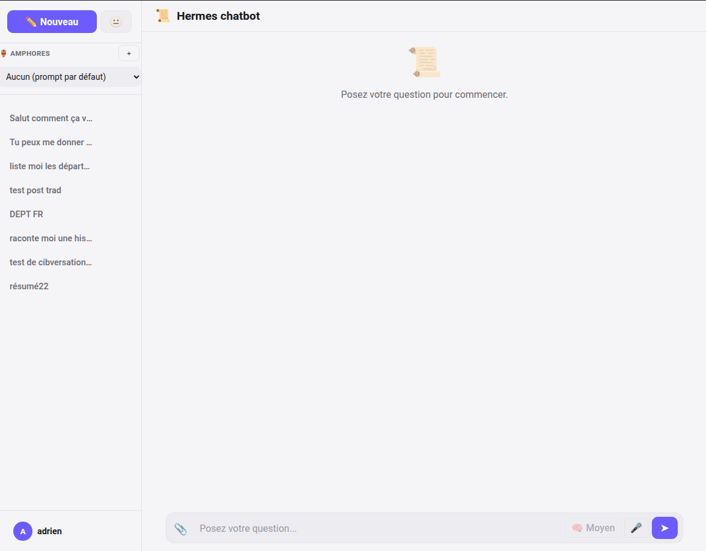

# Hermes — chatbot perso avec gestion d'outils — portage PHP (testé avec llama.cpp)

> 📄 Version française. [English version: README.md](README.md)

- Agent conversationnel en **PHP** connecté à un modèle LLM tournant en local via **llama.cpp** (API compatible OpenAI).
- Interface web (**SPA** en HTML/CSS/JS vanilla) — portage de la version Streamlit/Python.
- Expérimentation de l'usage de tools (function calling), nécessite un modèle compatible.

__Pourquoi Hermès ?__

Dans la religion grecque antique, Hermès est le messager des dieux. Quoi de mieux pour nommer un outil qui est le messager de l'IA :)

## Aperçu



## Prérequis

### Sur le système

- **PHP 8.x** (8.1 minimum, testé sur 8.5) avec les extensions :
  - `curl` (appels LLM / web / OIDC)
  - `dom` + `SimpleXML` (lecture XML : XLSX, ODS, ODT, ODP, DOCX)
  - `zip` (ZipArchive : DOCX / XLSX / PPTX / ODS / ODT / ODP)
  - `pdo_sqlite` (base de données)
  - `mbstring` (traitement de l'UTF-8)
  - `openssl` (signature / vérification JWT RS256)
  - `json`
- **Composer** (gestion des dépendances PHP)
- Binaires système (selon les fonctionnalités activées) :
  - `ffmpeg` (transcription audio/vidéo) — obligatoire si `enable_transcrire_audio` ou `enable_transcrire_video_url`
  - `yt-dlp` (transcription de vidéos en ligne) — si `enable_transcrire_video_url`
  - `pdftotext` (poppler-utils) — extraction du texte des PDF joints

### Installation des dépendances système

```bash
# Debian / Ubuntu
sudo apt install php-cli php-curl php-xml php-zip php-sqlite3 php-mbstring php-openssl ffmpeg yt-dlp poppler-utils composer

# Fedora / RHEL
sudo dnf install php-cli php-curl php-xml php-zip php-pdo_sqlite php-mbstring php-openssl ffmpeg yt-dlp poppler-utils composer
```

_Vérification des extensions PHP :_

```bash
php -m | grep -E 'curl|dom|SimpleXML|zip|pdo_sqlite|mbstring|openssl|json'
```

### Installation des dépendances Composer

```bash
cd /chemin/vers/hermes-php
composer install
```

Cela installe automatiquement :

- **mpdf** → génération PDF (support UTF-8, polices, mise en page)
- **phpoffice/phpword** → génération / lecture DOCX et ODT
- **phpoffice/phpspreadsheet** → génération / lecture XLSX et ODS
- **phpoffice/phppresentation** → génération / lecture PPTX et ODP

## Arborescence

```
├── index.php                  # Front controller unique (API JSON + SSE, callback OIDC, SPA)
├── composer.json              # Dépendances (mpdf, PHPOffice)
├── .htaccess                  # Configuration Apache (production)
├── lib/                       # Classes PHP (namespace Hermes)
│   ├── bootstrap.php          #   Autoload, constantes, réglages de base
│   ├── Config.php             #   Lecture de la configuration (data/config.php)
│   ├── Database.php           #   SQLite (création automatique des tables)
│   ├── Http.php               #   Client HTTP (LLM, web, OIDC)
│   ├── Auth.php               #   Comptes (PBKDF2-SHA256), sessions
│   ├── Oidc.php               #   OIDC / SSO (JWT RS256, JWKS)
│   ├── Llm.php                #   Client LLM (outils, niveaux de raisonnement)
│   ├── Tools.php              #   Catalogue et exécution des outils
│   ├── Upload.php             #   Upload de fichiers (extraction par format)
│   ├── DocumentGenerator.php  #   Génération de documents (10 formats)
│   ├── Conversations.php      #   Persistance des conversations
│   └── Amphores.php           #   Amphores (globales + perso)
├── public/                    # SPA (HTML / CSS / JS vanilla)
│   ├── index.html
│   └── assets/                #   hermes.css, hermes.js
├── ressources/
│   └── config.php.example     # Modèle de configuration
├── data/                      # Données d'exécution (ignorées par git)
│   ├── config.php             #   Configuration de travail (créée automatiquement)
│   ├── hermes.db              #   Base SQLite (créée automatiquement au 1er lancement)
│   └── generated_files/       #   Fichiers générés (préfixe ID unique + .meta)
└── tests/                     # Fichiers Office d'exemple + scripts de tests manuels
```

## Serveurs `.cpp` (backends d'inférence)

Hermes ne fait qu'orchestrer des appels vers des serveurs d'inférence autohébergés, tous de la famille `.cpp` (llama.cpp et ses dérivés), chacun exposant une API compatible OpenAI.

Aucun n'est obligatoire à part llama.cpp. Les autres n'activent que des fonctionnalités optionnelles (transcription, génération d'image, synthèse vocale).

| Serveur | Fonctionnalité dans Hermes | Obligatoire |
|---|---|---|
| **llama.cpp** | Inférence LLM (conversation, appel d'outils) | Oui |
| **whisper.cpp** | Transcription audio/vidéo (upload + URL) | Non |
| **stablediffusion.cpp** | Génération d'image | Non |
| **audio.cpp** | Synthèse vocale (TTS) des réponses | Non |

Pour chacun, une vidéo d'installation et une fiche écrite (Linuxtricks) sont disponibles :

- **llama.cpp**
  - 🎥 Vidéo : https://www.youtube.com/watch?v=NFB-c7CoGm4
  - 📄 Fiche : https://www.linuxtricks.fr/wiki/ia-installer-llama-cpp-pour-servir-des-llm-nvidia-amd-cpu
- **whisper.cpp**
  - 🎥 Vidéo : https://www.youtube.com/watch?v=4y5wyLK8xjI
  - 📄 Fiche : https://www.linuxtricks.fr/wiki/ia-installer-whisper-cpp-pour-la-reconnaissance-vocale-nvidia-amd-cpu
- **stablediffusion.cpp**
  - 🎥 Vidéo : https://www.youtube.com/watch?v=GeIegX8gdR4
  - 📄 Fiche : https://www.linuxtricks.fr/wiki/ia-installer-stablediffusion-cpp-pour-la-generation-d-image-nvidia-amd-cpu
- **audio.cpp**
  - 🎥 Vidéo : https://www.youtube.com/watch?v=5vle0ONwmvs
  - 📄 Fiche : https://www.linuxtricks.fr/wiki/ia-installer-audio-cpp-pour-la-synthese-vocale-nvidia-amd-cpu

_Note :_ ces serveurs peuvent tourner sur la même machine qu'Hermes ou sur des machines distinctes (y compris différentes les unes des autres). Seule l'URL configurée dans `data/config.php` (`base_url` de chaque section) compte.

## Outils disponibles

Chaque outil est activable / désactivable individuellement dans `data/config.php` (section `tools`). Le LLM ne voit que les outils activés.

| Outil | Rôle | Clé de config |
|---|---|---|
| 🌤️ `toolWeather` | Météo (Open-Meteo) | `enable_meteo` |
| 📖 `toolWiki` | Recherche Wikipédia | `enable_wiki` |
| 💱 `toolCurrency` | Conversion de devises | `enable_argent` |
| 🔍 `toolDuckDuckGo` | Recherche web | `enable_duckduckgo` |
| 🌐 `toolFetchPage` | Téléchargement et lecture du texte d'une page web | `enable_recup_page` |
| 🕐 `toolDateTime` | Date et heure du serveur | `enable_datetime` |
| 💾 `generateFile` | Génération d'un fichier téléchargeable (10 formats) | `enable_generer_fichier` |
| 🎙️ `transcribeAudio` | Transcription d'un fichier audio/vidéo joint | `enable_transcrire_audio` |
| 📡 `transcribeVideoUrl` | Transcription d'une vidéo en ligne (URL) | `enable_transcrire_video_url` |
| 🎨 `generateImage` | Génération d'image (stablediffusion.cpp) | `enable_generation_image` |

## Génération de fichiers (export)

L'outil `generateFile` génère un fichier téléchargeable à partir d'un contenu textuel (texte brut ou markdown) dans **10 formats** :

| Format | Type | Moteur |
|---|---|---|
| `txt` | texte brut | aucun (texte brut) |
| `md` | Markdown | aucun (texte brut) |
| `csv` | tableau (séparé par des virgules) | aucun (texte brut) |
| `pdf` | document | mpdf |
| `docx` | document (Microsoft) | phpoffice/phpword |
| `odt` | document (format ouvert ODF) | phpoffice/phpword |
| `xlsx` | tableur (Microsoft) | phpoffice/phpspreadsheet |
| `ods` | tableur (format ouvert ODF) | phpoffice/phpspreadsheet |
| `pptx` | présentation (Microsoft) | phpoffice/phppresentation |
| `odp` | présentation (format ouvert ODF) | phpoffice/phppresentation |

Les formats **ODF** (`odt`, `ods`, `odp`) sont les équivalents ouverts des formats Office (LibreOffice / OpenOffice) ; le LLM les utilise quand l'utilisateur demande explicitement un fichier ODF. Les paires `docx/odt`, `xlsx/ods` et `pptx/odp` partagent le même contenu : seul le writer (OOXML ou OpenDocument) change.

Pour les **présentations** (`pptx` / `odp`), le contenu est écrit en markdown :

- le premier titre `#` devient la diapositive de titre,
- chaque `##` ou `###` ouvre une nouvelle diapositive,
- les listes (`-` ou `1.`) deviennent des puces,
- les tableaux en pipes (`| a | b |`) deviennent des tableaux.

**Téléchargement** : le lien de téléchargement est inséré **à la fin du message texte** de l'assistant (et non dans le bloc outil) ; il reste disponible après rechargement de la conversation. Seuls les fichiers de la conversation en cours sont téléchargeables, et uniquement par l'utilisateur qui les a générés. Les fichiers sont stockés dans `data/generated_files/` avec un **préfixe d'ID unique** pour éviter toute collision de noms.

## Upload de fichiers (import)

L'interface web permet de joindre un fichier à un message. Le contenu est extrait selon le format et injecté dans le contexte du LLM (limite configurable : `web.limite_contexte_fichier`, 65 536 caractères par défaut) :

| Type | Formats | Traitement |
|---|---|---|
| Images | `png`, `jpg`, `jpeg`, `gif`, `webp` | encodage base64 (modèles multimodaux) |
| Texte | `txt`, `md`, `py`, `sh`, `conf`, `ini`, `log`, `yaml`, `yml`, `json`, `xml`, `html`, `css`, `js`, `ts` | lecture brute UTF-8 |
| Tableur (CSV) | `csv` | parsing natif (`fgetcsv`) |
| PDF | `pdf` | extraction `pdftotext` (poppler-utils) |
| Tableur (bureau) | `xlsx`, `ods` | phpoffice/phpspreadsheet |
| Document | `docx`, `odt` | phpoffice/phpword |
| Présentation | `pptx`, `odp` | phpoffice/phppresentation |
| Bureautique legacy | `xls`, `ppt` | message invitant à convertir vers le format moderne |
| Audio / vidéo | `wav`, `aiff`, `flac`, `ogg`, `mp3`, `m4a`, `mp4`, `mkv`, `mov`, `avi` | bytes bruts conservés (transcription à la demande, voir ci-dessous) |

## Transcription de fichiers audio / vidéo joints

Contrairement aux autres fichiers, un audio ou une vidéo joint **n'est pas transcrit immédiatement à l'upload** : le fichier est simplement joint au message, et c'est le LLM qui décide de déclencher la transcription via l'outil `transcribeAudio`. Il peut aussi ignérer les premières / dernières secondes sur demande (« enlève les 5 premières minutes »).

Pour les fichiers **vidéo**, la piste audio est d'abord extraite et convertie en WAV via **ffmpeg** avant l'envoi à whisper.cpp. De fait, `ffmpeg` doit être installé et accessible dans le `PATH` de la machine qui héberge ce projet (pas sur le serveur d'inférence).

```php
'tools' => [
    'enable_transcrire_audio' => 'true',
],
```

## Transcription de vidéos en ligne (YouTube, Twitch, etc. via yt-dlp)

En plus des fichiers uploadés, le LLM peut transcrire directement une vidéo à partir de son **URL**, grâce à l'outil `transcribeVideoUrl`. Il suffit de coller un lien vidéo dans le message pour que l'outil soit déclenché **automatiquement** (détection déterministe côté serveur, avant même l'appel au LLM).

La piste **audio uniquement** est téléchargée via **yt-dlp**, normalisée via ffmpeg, puis transcrite via whisper.cpp.

Par sécurité, seuls les domaines explicitement autorisés peuvent être utilisés ; la vérification est faite **côté serveur** (pas seulement dans la description donnée au LLM) :

```php
'video_url' => [
    'domaines_autorises' => 'youtube.com, twitch.tv, arte.tv',
],
'tools' => [
    'enable_transcrire_video_url' => 'true',
],
```

`yt-dlp` et `ffmpeg` doivent être installés et accessibles dans le `PATH`.

## Génération d'image

Le LLM peut générer une image à partir d'une simple description texte (prompt) via l'outil `generateImage`, qui s'appuie sur un serveur **stablediffusion.cpp** (API compatible OpenAI `/v1/images/generations`).

```php
'image' => [
    'base_url' => 'http://localhost:8082',
    'endpoint' => '/v1/images/generations',
    'size' => '512x512',
    'steps' => '',
],
```

L'image générée s'affiche directement dans la conversation (interface web), avec un bouton de téléchargement.

## Synthèse vocale des réponses (TTS via audio.cpp)

Chaque réponse de l'assistant peut être écoutée via un bouton **« 🔊 Écouter »**, qui envoie le texte à un serveur **audio.cpp** local (API compatible OpenAI `/v1/audio/speech`) et joue l'audio généré directement dans le navigateur.

```php
'audio' => [
    'base_url' => 'http://localhost:8083',
    'endpoint' => '/v1/audio/speech',
    'model' => 'qwen3-tts',
    'voice' => 'Sohee',
    'language' => 'fr',
    'tts' => 'true',
],
```

- **`model`** doit correspondre **exactement** à l'`id` du modèle TTS configuré côté serveur audio.cpp.
- **`voice`** permet pour les modèles proposant plusieurs voix de sélectionner celle souhaitée.
- **`tts = false`** masque simplement le bouton « 🔊 Écouter » partout dans l'interface, sans appel réseau.

## Dictée vocale (via whisper.cpp)

Un bouton **« 🎤 »** dans la saisie de message permet la dictée vocale : l'enregistrement (`MediaRecorder` natif, webm/opus ou mp4/aac selon le navigateur — aucune bibliothèque client) est envoyé à l'endpoint `/api/dictation`, normalisé avec ffmpeg (même chaîne `silenceremove` + `atempo=1.2` que la transcription de fichiers), puis transcrit par le serveur **whisper.cpp**. Le texte obtenu est inséré dans la zone de saisie — entièrement modifiable avant l'envoi — et n'est ni stocké ni joint.

- Le bouton n'est affiché que si le navigateur supporte `getUserMedia` (HTTPS ou localhost requis) et si `whisper.dictation = true` ; l'endpoint renvoie 403 dans le cas contraire. La dictée est indépendante de l'outil `transcribeAudio` (`tools.enable_transcrire_audio`), réservé à la transcription des fichiers audio/vidéo joints à la conversation.
- L'enregistrement est limité à **5 minutes** (arrêt automatique) ; le serveur refuse aussi les enregistrements de plus de 10 minutes ou de plus de 25 Mo.
- **`dictation = false`** masque simplement le bouton « 🎤 » dans l'interface, sans appel réseau.

## Niveaux de raisonnement

Si le modèle supporte plusieurs niveaux de raisonnement, un sélecteur (🧠) dans l'interface permet de choisir le niveau pour chaque message (`none`, `minimal`, `low`, `medium`, `high`, `xhigh`). Un niveau peut aussi être fixé dans la config (`llm.raisonnement`) ; s'il est vide, c'est le choix de l'utilisateur qui prime.

## Amphores : contextes système personnalisés

Une **amphore** est un contexte préconfiguré : un nom, une description optionnelle, et surtout un **prompt système** qui remplace celui défini par défaut dans `data/config.php`. C'est un moyen rapide de changer le comportement de l'IA (ex : « Expert Python », « Correcteur orthographique », « Traducteur Anglais vers Français »…) sans éditer la configuration ni redémarrer le serveur.

Dans l'interface web, un menu déroulant dans la sidebar permet de choisir l'amphore active : le changement s'applique immédiatement au message système de la conversation en cours, sans réinitialiser l'historique.

### Deux origines d'amphores

- **🌐 Globales** : partagées par tout le monde, stockées dans `hermes.db`. Créées / modifiées / supprimées uniquement par les comptes **administrateurs** (panneau « 🛠️ Administration » → « Amphores globales »).
- **👤 Perso** : propres à chaque utilisateur authentifié, stockées dans `hermes.db`. Invisibles et non modifiables par les autres utilisateurs. Nécessitent `authentification = userpass`.

### Configuration (section `amphores`)

```php
'amphores' => [
    // Visibilité des amphores dans l'interface :
    // disabled : amphores non disponibles (défaut)
    // user     : disponibles uniquement pour les utilisateurs authentifiés
    // all      : disponibles pour tout le monde, authentifié ou non
    'mode' => 'disabled',
],
```

## Comptes utilisateurs & historique des conversations

L'interface web peut fonctionner selon deux modes, paramétrés dans `data/config.php` :

```php
'auth' => [
    'authentification' => 'none',   // ou 'userpass'
    'register' => 'off',            // ou 'on'
],
```

### `authentification = none` (par défaut)

Comportement éphémère : pas de compte, pas de sauvegarde des conversations. Chaque session de navigateur repart de zéro.

### `authentification = userpass`

Active la gestion de comptes (utilisateur/mot de passe, hachage **PBKDF2-SHA256**) et la sauvegarde des conversations, stockées dans **`hermes.db`** (base SQLite créée automatiquement au premier lancement, aucun serveur de base de données externe requis).

Un compte administrateur par défaut est créé à l'initialisation : **`admin` / `admin`** (à changer immédiatement).

Une fois connecté, chaque échange est automatiquement enregistré. La sidebar propose de lister, reprendre, renommer et supprimer ses conversations. Un bouton **🫥 « éphémère »** permet de mener une conversation qui ne sera **pas sauvegardée**, même en mode `userpass`.

Si on veut autoriser la création de compte (juste username + pass, pas de mail), mettre **`register`** à `on`.

Le profil (accessible via le menu utilisateur) permet de changer le **thème** (clair / sombre) et le **mot de passe**. Les administrateurs disposent en outre d'un panneau d'**administration** : gestion des comptes (création, suppression, statut admin), gestion des amphores globales et édition de la configuration système.

## Authentification OIDC / SSO

En complément des comptes locaux (username/mot de passe), Hermes peut proposer un bouton **« Se connecter avec OIDC »** s'appuyant sur un fournisseur d'identité OIDC (Keycloak, ou tout IdP standard exposant un endpoint `.well-known/openid-configuration`). Les deux modes de connexion coexistent.

Nécessite `authentification = userpass` (l'OIDC vient en complément des comptes locaux, pas en remplacement).

### Configuration (section `oidc`)

```php
'oidc' => [
    'enabled' => 'false',
    'issuer' => 'https://sso.example.org/realms/mon-realm',
    'client_id' => 'hermes',
    'client_secret' => 'CHANGE_MOI',
    'redirect_uri' => 'http://localhost:8501/',
    'scope' => 'openid profile email',
],
```

### Fonctionnement

- **Premier login SSO** : le compte local associé est créé automatiquement (identifié de façon stable par le claim `sub` du id_token). Un mot de passe local aléatoire non utilisable est attribué.
- **Session** : un utilisateur SSO obtient la même session persistante (cookie navigateur) qu'un utilisateur local.
- **Mot de passe** : un utilisateur OIDC ne peut pas changer son mot de passe dans Hermes ; ces comptes sont badgés `🔐 SSO`. Le statut administrateur reste modifiable.
- **Déconnexion** : seule la session locale Hermes est fermée.

## Lancement

### Configuration

La configuration se trouve dans **`data/config.php`** (fichier PHP retournant un tableau). S'il est absent, il est **créé automatiquement** à partir de `ressources/config.php.example` au premier lancement. Il suffit donc d'éditer `data/config.php` :

```bash
# optionnel : créer la config explicitement
mkdir -p data
cp ressources/config.php.example data/config.php
```

Personnalisez éventuellement ce fichier selon ce que vous souhaitez !

### Interface web — mode développement (serveur PHP intégré)

```bash
php -S 0.0.0.0:8501 index.php
```

Puis ouvrez <http://localhost:8501>.

### Interface web — production (Apache)

Le front controller `index.php` + `.htaccess` suffisent pour la production :

1. Placer le projet dans le `DocumentRoot` d'Apache.
2. S'assurer que `mod_rewrite` est activé et que l'`AllowOverride` est `All`.
3. Le `.htaccess` route toutes les requêtes vers `index.php` et protège les données (interdit l'accès HTTP direct aux `.db`, `.conf`, `.log`, ...).

#### Exemple HTTPS (Fedora / RHEL)

Exemple de virtual host Apache dans **`/etc/httpd/conf.d/hermes.conf`** : le port 80 redirige vers le 443, et le site est servi en HTTPS sur le virtual host `hermes.linuxtricks.fr` :

```apache
# /etc/httpd/conf.d/hermes.conf

# HTTP (port 80) — redirection permanente vers HTTPS
<VirtualHost *:80>
    ServerName hermes.linuxtricks.fr
    Redirect permanent / https://hermes.linuxtricks.fr/
</VirtualHost>

# HTTPS (port 443)
<VirtualHost *:443>
    ServerName hermes.linuxtricks.fr
    DocumentRoot /var/www/hermes

    <Directory /var/www/hermes>
        AllowOverride All
        Require all granted
    </Directory>

    SSLEngine on
    SSLCertificateFile      /etc/pki/tls/certs/hermes.linuxtricks.fr.crt
    SSLCertificateKeyFile   /etc/pki/tls/private/hermes.linuxtricks.fr.key
    SSLCertificateChainFile /etc/pki/tls/certs/hermes.linuxtricks.fr.chain.crt
</VirtualHost>
```

_Notes :_
- Nécessite `mod_ssl` (la directive `Listen 443` est activée par défaut une fois mod_ssl installé).
- Ajustez les chemins `SSLCertificate*` à votre installation — avec Let's Encrypt / `certbot --apache`, ils sont gérés automatiquement (`/etc/letsencrypt/live/hermes.linuxtricks.fr/fullchain.pem` et `privkey.pem`).
- Une fois derrière HTTPS, mettez à jour la section `oidc` en conséquence : `'redirect_uri' => 'https://hermes.linuxtricks.fr/'`.

#### SELinux (RHEL / Fedora / CentOS)

Avec SELinux en mode `enforcing` (le défaut), Apache se voit refuser les écritures dans `data/` (base SQLite, sessions, uploads, verrous de stop) même quand les permissions POSIX sont correctes. Étiquetez le dossier comme contenu writable par httpd :

```bash
# Règle persistante (s'applique aussi aux nouveaux fichiers) — `semanage`
# est fourni par le paquet `policycoreutils` (`sudo dnf install policycoreutils`).
sudo semanage fcontext -a -t httpd_sys_rw_content_t '/chemin/vers/hermes-php/data(/.*)?'
sudo restorecon -R '/chemin/vers/hermes-php/data'

# Alternative rapide (sans règle persistante) :
sudo chcon -R -t httpd_sys_rw_content_t /chemin/vers/hermes-php/data
```

Vérifiez avec `ls -Z data/` (le contexte doit être `httpd_sys_rw_content_t`). En cas de refus persistant : `sudo ausearch -m avc -ts recent`.

## Référentiel de configuration

| Section | Clé | Défaut | Rôle |
|---|---|---|---|
| `llm` | `base_url` | `http://localhost:8080/v1` | Endpoint compatible OpenAI du serveur LLM |
| `llm` | `api_key` | `sk-no-key-required` | Clé API (ignorée par llama.cpp) |
| `llm` | `model` | `default` | Nom du modèle |
| `llm` | `max_tokens` | `65536` | Tokens max par réponse |
| `llm` | `temperature` | `0.7` | Température |
| `llm` | `raisonnement` | *(vide)* | Niveau de raisonnement fixe (`none`…`xhigh`) ; vide = choix par message dans l'interface |
| `whisper` | `base_url` | `http://localhost:8081` | Serveur whisper.cpp |
| `whisper` | `endpoint` | `/inference` | Endpoint d'inférence |
| `whisper` | `response_format` | `json` | Format de réponse |
| `whisper` | `language` | `fr` | Langue de la transcription |
| `whisper` | `audio_format` | `wav` | Format audio envoyé à whisper |
| `whisper` | `dictation` | `true` | `false` masque le bouton de dictée vocale « 🎤 » |
| `video_url` | `domaines_autorises` | `youtube.com, twitch.tv, arte.tv` | Liste de domaines autorisés pour la transcription vidéo (vérifiée côté serveur) |
| `image` | `base_url` | `http://localhost:8082` | Serveur stablediffusion.cpp |
| `image` | `endpoint` | `/v1/images/generations` | Endpoint de génération d'image |
| `image` | `size` | `512x512` | Dimensions par défaut (LARGEURxHAUTEUR) |
| `image` | `steps` | *(vide)* | Nombre d'étapes (vide = défaut du serveur) |
| `audio` | `base_url` | `http://localhost:8083` | Serveur audio.cpp |
| `audio` | `endpoint` | `/v1/audio/speech` | Endpoint TTS |
| `audio` | `model` | `qwen3-tts` | Id du modèle TTS (doit correspondre à l'id côté serveur) |
| `audio` | `voice` | `Sohee` | Voix (si le modèle en propose plusieurs) |
| `audio` | `language` | `fr` | Langue |
| `audio` | `tts` | `true` | `false` masque le bouton « 🔊 Écouter » |
| `agent` | `system_prompt` | `Répond en français sauf avis contraire` | Prompt système par défaut |
| `tools` | `enable_*` | — | Activation de chaque outil (voir tableau « Outils disponibles ») |
| `amphores` | `mode` | `disabled` | `disabled` / `user` / `all` |
| `auth` | `authentification` | `none` | `none` (éphémère) / `userpass` (comptes + historique) |
| `auth` | `register` | `off` | Inscription ouverte (`on`) ou non (`off`) |
| `oidc` | `enabled` | `false` | SSO activé ou non |
| `oidc` | `issuer` | — | Émetteur OIDC |
| `oidc` | `client_id` | `hermes` | Identifiant client |
| `oidc` | `client_secret` | — | Secret client |
| `oidc` | `redirect_uri` | `http://localhost:8501/` | URL de callback |
| `oidc` | `scope` | `openid profile email` | Scopes demandés |
| `web` | `page_title` | `Hermes chatbot by Linuxtricks.fr` | Titre de l'onglet |
| `web` | `page_icon` | `📜` | Icône du site (emoji) |
| `web` | `header` | `Hermes chatbot by Linuxtricks.fr` | En-tête de l'interface |
| `web` | `limite_contexte_fichier` | `65536` | Caractères max d'un fichier joint injectés dans le contexte |
| `cli` | — | — | Section historique (aucune CLI dans la version actuelle) |

