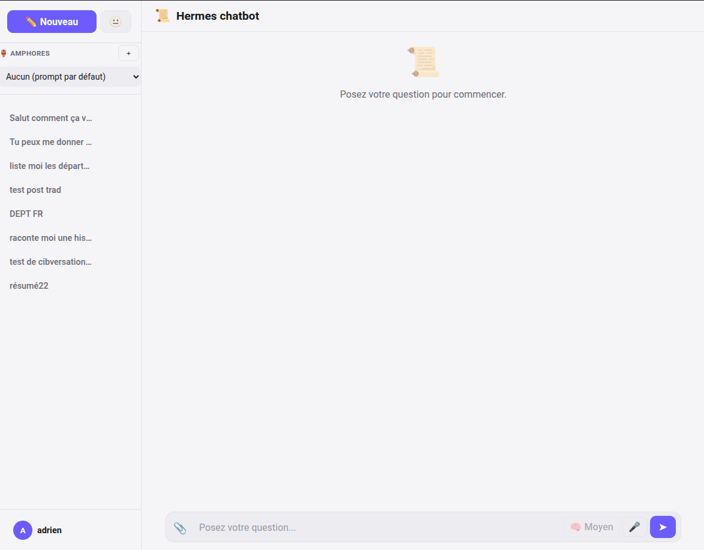

# Hermes — personal chatbot with tool management — PHP port (tested with llama.cpp)

> 📄 English version. [Version française : README.fr.md](README.fr.md)

- Conversational agent in **PHP** connected to a locally-running LLM via **llama.cpp** (OpenAI-compatible API).
- Web interface (**SPA** in vanilla HTML/CSS/JS) — port of the Streamlit/Python version.
- Experiment with tool usage (function calling); requires a compatible model.

__Why Hermes?__

In ancient Greek religion, Hermes is the messenger of the gods. What better name for a tool that acts as a messenger for AI :)

## Preview



## Prerequisites

### System requirements

- **PHP 8.x** (8.1 minimum, tested on 8.5) with the following extensions:
  - `curl` (LLM / web / OIDC calls)
  - `dom` + `SimpleXML` (XML parsing: XLSX, ODS, ODT, ODP, DOCX)
  - `zip` (ZipArchive: DOCX / XLSX / PPTX / ODS / ODT / ODP)
  - `pdo_sqlite` (database)
  - `mbstring` (UTF-8 handling)
  - `openssl` (JWT RS256 signing / verification)
  - `json`
- **Composer** (PHP dependency management)
- System binaries (depending on the features enabled):
  - `ffmpeg` (audio/video transcription) — required if `enable_transcrire_audio` or `enable_transcrire_video_url`
  - `yt-dlp` (online video transcription) — if `enable_transcrire_video_url`
  - `pdftotext` (poppler-utils) — text extraction from attached PDFs

### Installing system dependencies

```bash
# Debian / Ubuntu
sudo apt install php-cli php-curl php-xml php-zip php-sqlite3 php-mbstring php-openssl ffmpeg yt-dlp poppler-utils composer

# Fedora / RHEL
sudo dnf install php-cli php-curl php-xml php-zip php-pdo_sqlite php-mbstring php-openssl ffmpeg yt-dlp poppler-utils composer
```

_Checking the PHP extensions:_

```bash
php -m | grep -E 'curl|dom|SimpleXML|zip|pdo_sqlite|mbstring|openssl|json'
```

### Installing Composer dependencies

```bash
cd /path/to/hermes-php
composer install
```

This installs automatically:

- **mpdf** → PDF generation (UTF-8 support, fonts, layout)
- **phpoffice/phpword** → DOCX and ODT generation / reading
- **phpoffice/phpspreadsheet** → XLSX and ODS generation / reading
- **phpoffice/phppresentation** → PPTX and ODP generation / reading

## Project layout

```
├── index.php                  # Single front controller (JSON + SSE API, OIDC callback, SPA)
├── composer.json              # Dependencies (mpdf, PHPOffice)
├── .htaccess                  # Apache configuration (production)
├── lib/                       # PHP classes (Hermes namespace)
│   ├── bootstrap.php          #   Autoloader, constants, base settings
│   ├── Config.php             #   Configuration loader (data/config.php)
│   ├── Database.php           #   SQLite (automatic table creation)
│   ├── Http.php               #   HTTP client (LLM, web, OIDC)
│   ├── Auth.php               #   Accounts (PBKDF2-SHA256), sessions
│   ├── Oidc.php               #   OIDC / SSO (JWT RS256, JWKS)
│   ├── Llm.php                #   LLM client (tools, reasoning levels)
│   ├── Tools.php              #   Tool catalog and execution
│   ├── Upload.php             #   File uploads (per-format extraction)
│   ├── DocumentGenerator.php  #   Document generation (10 formats)
│   ├── Conversations.php      #   Conversation persistence
│   └── Amphores.php           #   Amphorae (global + personal)
├── public/                    # SPA (vanilla HTML / CSS / JS)
│   ├── index.html
│   └── assets/                #   hermes.css, hermes.js
├── ressources/
│   └── config.php.example     # Configuration template
├── data/                      # Runtime data (git-ignored)
│   ├── config.php             #   Working configuration (created automatically)
│   ├── hermes.db              #   SQLite database (created automatically on first run)
│   └── generated_files/       #   Generated files (unique ID prefix + .meta)
└── tests/                     # Sample Office files + manual test scripts
```

## `.cpp` servers (inference backends)

Hermes only orchestrates calls to self-hosted inference servers, all from the `.cpp` family (llama.cpp and its derivatives), each exposing an OpenAI-compatible API.

None of them is mandatory except llama.cpp. The others only enable optional features (transcription, image generation, speech synthesis).

| Server | Feature in Hermes | Required |
|---|---|---|
| **llama.cpp** | LLM inference (conversation, tool calls) | Yes |
| **whisper.cpp** | Audio/video transcription (upload + URL) | No |
| **stablediffusion.cpp** | Image generation | No |
| **audio.cpp** | Speech synthesis (TTS) of responses | No |

For each of them, an installation video and a written guide (Linuxtricks) are available:

- **llama.cpp**
  - 🎥 Video: https://www.youtube.com/watch?v=NFB-c7CoGm4
  - 📄 Guide: https://www.linuxtricks.fr/wiki/ia-installer-llama-cpp-pour-servir-des-llm-nvidia-amd-cpu
- **whisper.cpp**
  - 🎥 Video: https://www.youtube.com/watch?v=4y5wyLK8xjI
  - 📄 Guide: https://www.linuxtricks.fr/wiki/ia-installer-whisper-cpp-pour-la-reconnaissance-vocale-nvidia-amd-cpu
- **stablediffusion.cpp**
  - 🎥 Video: https://www.youtube.com/watch?v=GeIegX8gdR4
  - 📄 Guide: https://www.linuxtricks.fr/wiki/ia-installer-stablediffusion-cpp-pour-la-generation-d-image-nvidia-amd-cpu
- **audio.cpp**
  - 🎥 Video: https://www.youtube.com/watch?v=5vle0ONwmvs
  - 📄 Guide: https://www.linuxtricks.fr/wiki/ia-installer-audio-cpp-pour-la-synthese-vocale-nvidia-amd-cpu

_Note:_ these servers can run on the same machine as Hermes or on separate machines (including different ones from each other). Only the URL configured in `data/config.php` (the `base_url` of each section) matters.

## Available tools

Each tool can be enabled / disabled individually in `data/config.php` (the `tools` section). The LLM only sees the enabled tools.

| Tool | Purpose | Config key |
|---|---|---|
| 🌤️ `toolWeather` | Weather (Open-Meteo) | `enable_meteo` |
| 📖 `toolWiki` | Wikipedia search | `enable_wiki` |
| 💱 `toolCurrency` | Currency conversion | `enable_argent` |
| 🔍 `toolDuckDuckGo` | Web search | `enable_duckduckgo` |
| 🌐 `toolFetchPage` | Downloads and reads the text of a web page | `enable_recup_page` |
| 🕐 `toolDateTime` | Server date and time | `enable_datetime` |
| 💾 `generateFile` | Generates a downloadable file (10 formats) | `enable_generer_fichier` |
| 🎙️ `transcribeAudio` | Transcribes an attached audio/video file | `enable_transcrire_audio` |
| 📡 `transcribeVideoUrl` | Transcribes an online video (URL) | `enable_transcrire_video_url` |
| 🎨 `generateImage` | Image generation (stablediffusion.cpp) | `enable_generation_image` |

## File generation (export)

The `generateFile` tool generates a downloadable file from textual content (plain text or markdown) in **10 formats**:

| Format | Type | Engine |
|---|---|---|
| `txt` | plain text | none (raw text) |
| `md` | Markdown | none (raw text) |
| `csv` | comma-separated table | none (raw text) |
| `pdf` | document | mpdf |
| `docx` | document (Microsoft) | phpoffice/phpword |
| `odt` | document (open format ODF) | phpoffice/phpword |
| `xlsx` | spreadsheet (Microsoft) | phpoffice/phpspreadsheet |
| `ods` | spreadsheet (open format ODF) | phpoffice/phpspreadsheet |
| `pptx` | presentation (Microsoft) | phpoffice/phppresentation |
| `odp` | presentation (open format ODF) | phpoffice/phppresentation |

The **ODF** formats (`odt`, `ods`, `odp`) are the open-format equivalents of the Office formats (LibreOffice / OpenOffice); the LLM uses them when the user explicitly asks for an ODF file. The `docx/odt`, `xlsx/ods` and `pptx/odp` pairs share the same content: only the writer (OOXML or OpenDocument) changes.

For **presentations** (`pptx` / `odp`), the content is written in markdown:

- the first `#` heading becomes the title slide,
- each `##` or `###` heading opens a new slide,
- lists (`-` or `1.`) become bullet points,
- pipe tables (`| a | b |`) become tables.

**Downloading**: the download link is inserted **at the end of the assistant's text message** (not in the tool block); it stays available after the conversation is reloaded. Only the files of the current conversation are downloadable, and only by the user who generated them. Files are stored in `data/generated_files/` with a **unique ID prefix** to avoid any filename collision.

## File uploads (import)

The web interface allows attaching a file to a message. The content is extracted according to the format and injected into the LLM context (configurable limit: `web.limite_contexte_fichier`, 65,536 characters by default):

| Type | Formats | Processing |
|---|---|---|
| Images | `png`, `jpg`, `jpeg`, `gif`, `webp` | base64 encoding (multimodal models) |
| Text | `txt`, `md`, `py`, `sh`, `conf`, `ini`, `log`, `yaml`, `yml`, `json`, `xml`, `html`, `css`, `js`, `ts` | raw UTF-8 read |
| Spreadsheet (CSV) | `csv` | native parsing (`fgetcsv`) |
| PDF | `pdf` | `pdftotext` extraction (poppler-utils) |
| Spreadsheet (office) | `xlsx`, `ods` | phpoffice/phpspreadsheet |
| Document | `docx`, `odt` | phpoffice/phpword |
| Presentation | `pptx`, `odp` | phpoffice/phppresentation |
| Legacy office | `xls`, `ppt` | message asking to convert to the modern format |
| Audio / video | `wav`, `aiff`, `flac`, `ogg`, `mp3`, `m4a`, `mp4`, `mkv`, `mov`, `avi` | raw bytes kept (transcription on demand, see below) |

## Transcribing attached audio / video files

Unlike other files, an attached audio or video file is **not transcribed immediately on upload**: the file is simply attached to the message, and the LLM decides whether to trigger the transcription via the `transcribeAudio` tool. It can also skip the first / last seconds on request ("remove the first 5 minutes").

For **video** files, the audio track is first extracted and converted to WAV via **ffmpeg** before being sent to whisper.cpp. Therefore `ffmpeg` must be installed and available in the `PATH` of the machine hosting this project (not the inference server).

```php
'tools' => [
    'enable_transcrire_audio' => 'true',
],
```

## Transcribing online videos (YouTube, Twitch, etc. via yt-dlp)

In addition to uploaded files, the LLM can transcribe a video directly from its **URL**, thanks to the `transcribeVideoUrl` tool. Simply paste a video link in the message and the tool is triggered **automatically** (deterministic detection server-side, before the LLM call).

The **audio-only** track is downloaded via **yt-dlp**, normalized with ffmpeg, then transcribed via whisper.cpp.

For security, only explicitly allowed domains can be used; the check is done **server-side** (not only in the description given to the LLM):

```php
'video_url' => [
    'domaines_autorises' => 'youtube.com, twitch.tv, arte.tv',
],
'tools' => [
    'enable_transcrire_video_url' => 'true',
],
```

Both `yt-dlp` and `ffmpeg` must be installed and available in the `PATH`.

## Image generation

The LLM can generate an image from a simple text description (prompt) via the `generateImage` tool, backed by a **stablediffusion.cpp** server (OpenAI-compatible API `/v1/images/generations`).

```php
'image' => [
    'base_url' => 'http://localhost:8082',
    'endpoint' => '/v1/images/generations',
    'size' => '512x512',
    'steps' => '',
],
```

The generated image is displayed directly in the conversation (web interface), with a download button.

## Speech synthesis of responses (TTS via audio.cpp)

Every assistant response can be listened to via an **"🔊 Listen"** button, which sends the text to a local **audio.cpp** server (OpenAI-compatible API `/v1/audio/speech`) and plays the generated audio directly in the browser.

```php
'audio' => [
    'base_url' => 'http://localhost:8083',
    'endpoint' => '/v1/audio/speech',
    'model' => 'qwen3-tts',
    'voice' => 'Sohee',
    'language' => 'fr',
    'tts' => 'true',
],
```

- **`model`** must match **exactly** the `id` of the TTS model configured on the audio.cpp server.
- **`voice`** selects the desired voice for models offering several.
- **`tts = false`** simply hides the "🔊 Listen" button everywhere in the interface, with no network call.

## Voice dictation (via whisper.cpp)

A **"🎤"** button in the message input allows voice dictation: the recording (native `MediaRecorder`, webm/opus or mp4/aac depending on the browser — no client library) is sent to the `/api/dictation` endpoint, normalized with ffmpeg (same `silenceremove` + `atempo=1.2` chain as file transcription), then transcribed by the **whisper.cpp** server. The resulting text is inserted into the input field — fully editable before sending — and is neither stored nor attached.

- The button is only shown if the browser supports `getUserMedia` (HTTPS or localhost required) and if `whisper.dictation = true`; the endpoint returns 403 otherwise. Dictation is independent of the `transcribeAudio` tool (`tools.enable_transcrire_audio`), which is only used for transcribing audio/video files attached to a conversation.
- Recording is capped at **5 minutes** (auto-stop); the server also rejects recordings longer than 10 minutes or larger than 25 Mo.
- **`dictation = false`** simply hides the "🎤" button in the interface, with no network call.

## Reasoning levels

If the model supports several reasoning levels, a selector (🧠) in the interface lets you choose the level for each message (`none`, `minimal`, `low`, `medium`, `high`, `xhigh`). A level can also be fixed in the configuration (`llm.raisonnement`); when it is empty, the user's per-message choice takes precedence.

## Amphorae: custom system contexts

An **amphora** is a preconfigured context: a name, an optional description, and above all a **system prompt** that replaces the default one defined in `data/config.php`. It is a quick way to change the AI's behavior (e.g. "Python expert", "Spelling corrector", "English-to-French translator"...) without editing the configuration or restarting the server.

In the web interface, a dropdown in the sidebar lets you choose the active amphora: the change is applied immediately to the system message of the current conversation, without resetting the history.

### Two origins of amphorae

- **🌐 Global**: shared by everyone, stored in `hermes.db`. Created / modified / deleted only by **administrator** accounts (the "🛠️ Administration" panel → "Global amphorae").
- **👤 Personal**: owned by each authenticated user, stored in `hermes.db`. Invisible and not modifiable by other users. Requires `authentification = userpass`.

### Configuration (`amphores` section)

```php
'amphores' => [
    // Amphora visibility in the interface:
    // disabled : amphorae not available (default)
    // user     : available only to authenticated users
    // all      : available to everyone, authenticated or not
    'mode' => 'disabled',
],
```

## User accounts & conversation history

The web interface can run in two modes, configured in `data/config.php`:

```php
'auth' => [
    'authentification' => 'none',   // or 'userpass'
    'register' => 'off',            // or 'on'
],
```

### `authentification = none` (default)

Ephemeral behavior: no accounts, no conversation saving. Each browser session starts from scratch.

### `authentification = userpass`

Enables account management (username/password, **PBKDF2-SHA256** hashing) and conversation saving, stored in **`hermes.db`** (SQLite database created automatically on first run, no external database server required).

A default administrator account is created at initialization: **`admin` / `admin`** (change it immediately).

Once logged in, every exchange is automatically recorded. The sidebar lets you list, resume, rename and delete your conversations. A **🫥 "ephemeral"** button allows having a conversation that will **not be saved**, even in `userpass` mode.

If you want to allow account creation (just username + pass, no email), set **`register`** to `on`.

The profile (accessible from the user menu) lets you change the **theme** (light / dark) and the **password**. Administrators additionally get an **administration** panel: account management (creation, deletion, admin status), global amphora management and editing of the system configuration.

## OIDC / SSO authentication

In addition to local accounts (username/password), Hermes can offer a **"Connect with OIDC"** button backed by an OIDC identity provider (Keycloak, or any standard IdP exposing a `.well-known/openid-configuration` endpoint). Both login modes coexist.

Requires `authentification = userpass` (OIDC complements local accounts, it does not replace them).

### Configuration (`oidc` section)

```php
'oidc' => [
    'enabled' => 'false',
    'issuer' => 'https://sso.example.org/realms/mon-realm',
    'client_id' => 'hermes',
    'client_secret' => 'CHANGE_ME',
    'redirect_uri' => 'http://localhost:8501/',
    'scope' => 'openid profile email',
],
```

### How it works

- **First SSO login**: the associated local account is created automatically (stably identified by the `sub` claim of the id_token). A random, unusable local password is assigned.
- **Session**: an SSO user gets the same persistent session (browser cookie) as a local user.
- **Password**: an OIDC user cannot change their password in Hermes; these accounts are badged `🔐 SSO`. The administrator status remains changeable.
- **Logout**: only the local Hermes session is closed.

## Running

### Configuration

The configuration lives in **`data/config.php`** (a PHP file returning an array). If it is missing, it is **created automatically** from `ressources/config.php.example` on first run. You only need to edit `data/config.php`:

```bash
# optional: create the config explicitly
mkdir -p data
cp ressources/config.php.example data/config.php
```

Customize this file as you wish!

### Web interface — development mode (built-in PHP server)

```bash
php -S 0.0.0.0:8501 index.php
```

Then open <http://localhost:8501>.

### Web interface — production (Apache)

The front controller `index.php` + `.htaccess` are enough for production:

1. Place the project in the Apache `DocumentRoot`.
2. Make sure `mod_rewrite` is enabled and `AllowOverride` is `All`.
3. The `.htaccess` routes all requests to `index.php` and protects the data (direct HTTP access to `.db`, `.conf`, `.log`, ... is denied).

#### HTTPS example (Fedora / RHEL)

Example of an Apache vhost in **`/etc/httpd/conf.d/hermes.conf`**: port 80 redirects to 443, and the site is served over HTTPS on the `hermes.linuxtricks.fr` virtual host:

```apache
# /etc/httpd/conf.d/hermes.conf

# HTTP (port 80) — permanent redirect to HTTPS
<VirtualHost *:80>
    ServerName hermes.linuxtricks.fr
    Redirect permanent / https://hermes.linuxtricks.fr/
</VirtualHost>

# HTTPS (port 443)
<VirtualHost *:443>
    ServerName hermes.linuxtricks.fr
    DocumentRoot /var/www/hermes

    <Directory /var/www/hermes>
        AllowOverride All
        Require all granted
    </Directory>

    SSLEngine on
    SSLCertificateFile      /etc/pki/tls/certs/hermes.linuxtricks.fr.crt
    SSLCertificateKeyFile   /etc/pki/tls/private/hermes.linuxtricks.fr.key
    SSLCertificateChainFile /etc/pki/tls/certs/hermes.linuxtricks.fr.chain.crt
</VirtualHost>
```

_Notes:_
- Requires `mod_ssl` (`Listen 443` is enabled by default once mod_ssl is installed).
- Adjust the `SSLCertificate*` paths to your setup — with Let's Encrypt / `certbot --apache`, they are managed automatically (`/etc/letsencrypt/live/hermes.linuxtricks.fr/fullchain.pem` and `privkey.pem`).
- Once behind HTTPS, update the `oidc` section accordingly: `'redirect_uri' => 'https://hermes.linuxtricks.fr/'`.

## Configuration reference

| Section | Key | Default | Purpose |
|---|---|---|---|
| `llm` | `base_url` | `http://localhost:8080/v1` | OpenAI-compatible endpoint of the LLM server |
| `llm` | `api_key` | `sk-no-key-required` | API key (ignored by llama.cpp) |
| `llm` | `model` | `default` | Model name |
| `llm` | `max_tokens` | `65536` | Max tokens per response |
| `llm` | `temperature` | `0.7` | Temperature |
| `llm` | `raisonnement` | *(empty)* | Fixed reasoning level (`none`…`xhigh`); empty = per-message choice in the interface |
| `whisper` | `base_url` | `http://localhost:8081` | whisper.cpp server |
| `whisper` | `endpoint` | `/inference` | Inference endpoint |
| `whisper` | `response_format` | `json` | Response format |
| `whisper` | `language` | `fr` | Transcription language |
| `whisper` | `audio_format` | `wav` | Audio format sent to whisper |
| `whisper` | `dictation` | `true` | `false` hides the "🎤" voice dictation button |
| `video_url` | `domaines_autorises` | `youtube.com, twitch.tv, arte.tv` | Whitelist of domains allowed for video transcription (checked server-side) |
| `image` | `base_url` | `http://localhost:8082` | stablediffusion.cpp server |
| `image` | `endpoint` | `/v1/images/generations` | Image generation endpoint |
| `image` | `size` | `512x512` | Default dimensions (WIDTHxHEIGHT) |
| `image` | `steps` | *(empty)* | Number of steps (empty = server default) |
| `audio` | `base_url` | `http://localhost:8083` | audio.cpp server |
| `audio` | `endpoint` | `/v1/audio/speech` | TTS endpoint |
| `audio` | `model` | `qwen3-tts` | TTS model id (must match the id on the server) |
| `audio` | `voice` | `Sohee` | Voice (if the model offers several) |
| `audio` | `language` | `fr` | Language |
| `audio` | `tts` | `true` | `false` hides the "🔊 Listen" button |
| `agent` | `system_prompt` | `Répond en français sauf avis contraire` | Default system prompt |
| `tools` | `enable_*` | — | Enabling each tool (see the "Available tools" table) |
| `amphores` | `mode` | `disabled` | `disabled` / `user` / `all` |
| `auth` | `authentification` | `none` | `none` (ephemeral) / `userpass` (accounts + history) |
| `auth` | `register` | `off` | Open registration (`on`) or not (`off`) |
| `oidc` | `enabled` | `false` | SSO on or off |
| `oidc` | `issuer` | — | OIDC issuer |
| `oidc` | `client_id` | `hermes` | Client id |
| `oidc` | `client_secret` | — | Client secret |
| `oidc` | `redirect_uri` | `http://localhost:8501/` | Callback URL |
| `oidc` | `scope` | `openid profile email` | Requested scopes |
| `web` | `page_title` | `Hermes chatbot by Linuxtricks.fr` | Tab title |
| `web` | `page_icon` | `📜` | Site icon (emoji) |
| `web` | `header` | `Hermes chatbot by Linuxtricks.fr` | Interface header |
| `web` | `limite_contexte_fichier` | `65536` | Max characters of an attached file injected into the context |
| `cli` | — | — | Legacy section (no CLI in the current release) |

